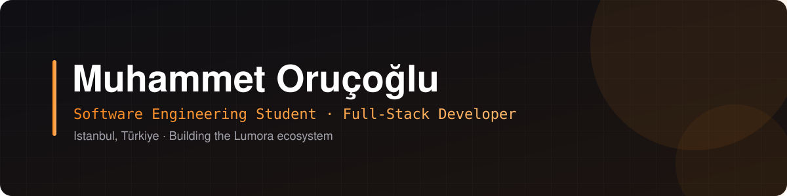

  

  
  
  
  
  

## About me

I'm a 3rd-year Software Engineering student in Istanbul. I build complete products end to end, from the database and API to the interface and deployment, and publish them as open source under the **Lumora** name. I'm currently looking for **internship and junior developer** opportunities.

## What I work on

<table>
  <tr>
    <td width="50%" valign="top">
      <b>Full-stack web</b> 
      Node.js, Next.js and SvelteKit apps with PostgreSQL and SQLite, from auth to deployment.
    </td>
    <td width="50%" valign="top">
      <b>Real-time systems</b> 
      Go and WebSocket servers for live collaboration, shared rooms and multiplayer sync.
    </td>
  </tr>
  <tr>
    <td width="50%" valign="top">
      <b>Desktop tools</b> 
      Windows apps in Python and C# / .NET, shipped as installers with auto-updates.
    </td>
    <td width="50%" valign="top">
      <b>Game development</b> 
      Godot projects with gameplay systems and an online co-op server.
    </td>
  </tr>
</table>

## Tech stack

| Area | Technologies |
| --- | --- |
| Languages |  |
| Frontend |  |
| Backend |  |
| Data |  |
| Mobile and games |  |
| Tools |  |

## Projects

All my projects, with screenshots, live demos and downloads, are on the **[Lumora projects page](https://lumorahub.pages.dev/en/projects/)**.

---

“What makes me better is not learning things, but building things.”

